# Short Temper

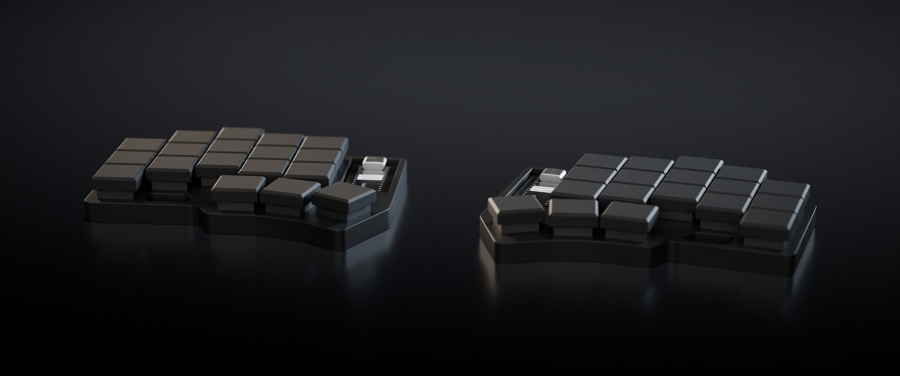

ZMK config for a Temper, a 36-key wireless split keyboard. Each half has a ProMicro NRF52840 (a
nice!nano v2 clone) and a socket for an optional nice!view screen. The screens only go on at a desk,
and the same firmware runs with or without them. It's based on the seller's repo,
[Sifan6688/Temper_zmk](https://github.com/Sifan6688/Temper_zmk), kept as the `upstream` remote.

## Keymap


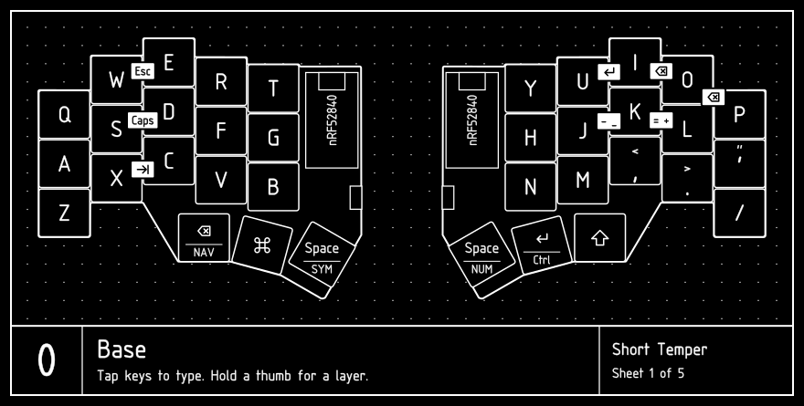
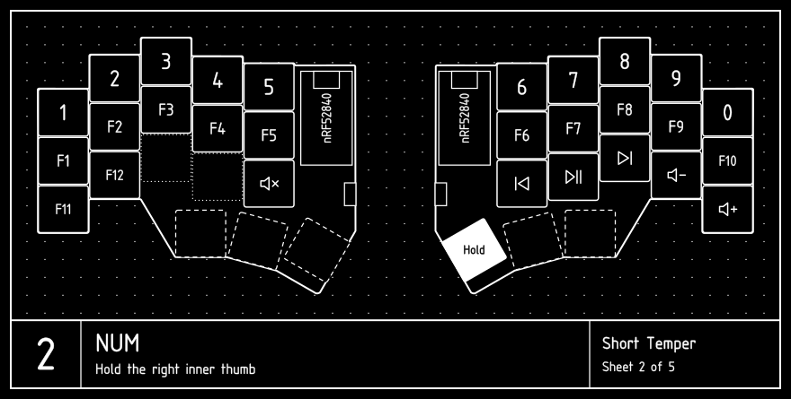
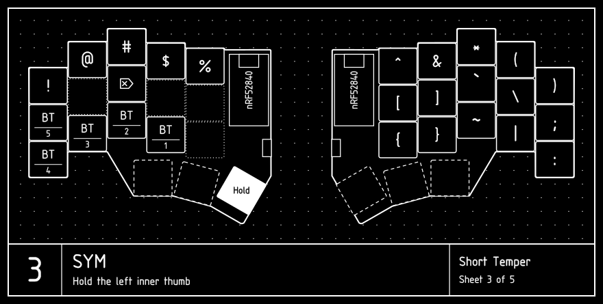
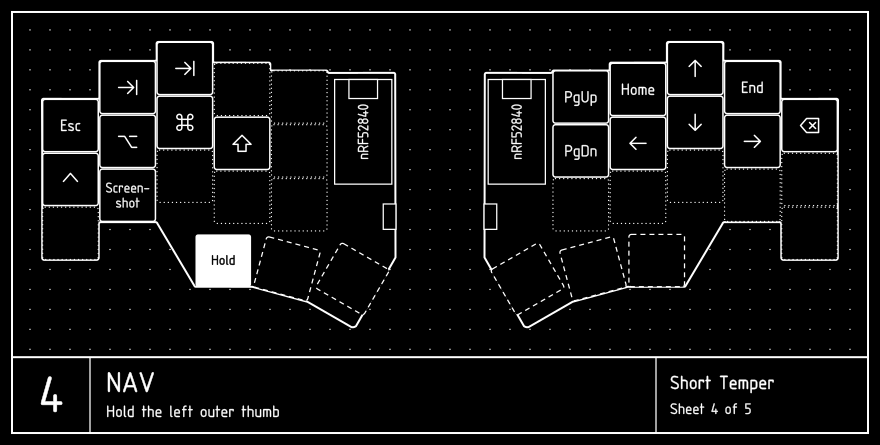
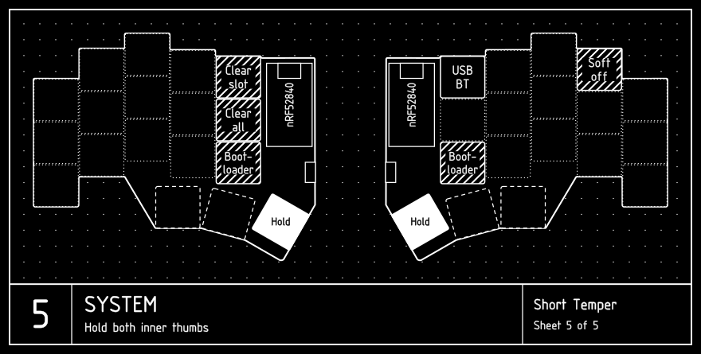

The drawings are generated from `config/temper.keymap`, so they win if this page disagrees. Key
positions and the board outline come from the [Temper PCB](https://github.com/gurland/temper).

## Reaching the layers

There's no number row, and only the thumbs switch layers. A layer lasts while you hold its thumb
key, and holding both Space thumbs opens SYSTEM.

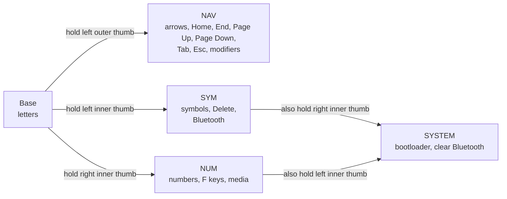

| Thumb key | Tap | Hold |
|---|---|---|
| Left outer | Backspace | NAV layer |
| Left middle | Cmd (Ctrl on Windows) | Cmd (Ctrl on Windows) |
| Left inner | Space | SYM layer |
| Right inner | Space | NUM layer |
| Right middle | Enter | Ctrl |
| Right outer | Shift | Shift |

### Common keys

NUM, on the right inner thumb:

| Press | To type |
|---|---|
| The top row, Q to P | 1 to 0 |
| The home row, A to ' | F1 to F10 |
| Z, X | F11, F12 |
| N, M, comma | Previous, Play, Next |
| Full stop, /, B | Volume down, Volume up, Mute |

SYM, on the left inner thumb:

| Press | To type |
|---|---|
| The top row | `!@#$%^&*()` |
| H, J, K, L, ' | `[` `]` `` ` `` `\` `;` |
| N, M, comma, full stop, / | `{` `}` `~` `\|` `:` |
| D | Delete |

NAV, on the left outer thumb:

| Press | To type |
|---|---|
| I, J, K, L | Up, left, down, right |
| U, O | Home, End |
| Y, H | Page Up, Page Down |
| W, Q | Tab, Esc |
| P | Backspace, which repeats while held |

### Modifiers with navigation

On NAV, A, S, D and F are Ctrl, Option, Cmd and Shift, so the left hand holds modifiers while the
right hand navigates:

| To do | Hold the left outer thumb, then |
|---|---|
| Jump a word | S + J or L |
| Select a word | S + F + J or L |
| Jump to line start or end | D + J or L |
| Switch apps (Cmd+Tab) | D + W, tapping W to move along |
| Alt+Tab | S + W, tapping W to move along |
| Switch Spaces (Ctrl+left or right) | A + J or L |
| Mission Control (Ctrl+up) | A + I |
| The app's windows (Ctrl+down) | A + K |

Holding Enter is Ctrl too, so for Spaces and Mission Control you can hold Enter instead of A, with
your left thumb on NAV. Home
and End scroll the whole document in many Mac apps, so use D + J or L to jump within a line.

### Combos

| Keys | Sends |
|---|---|
| Q + W | Tab |
| W + E | Esc |
| S + D | Caps Lock |
| U + I | Enter |
| I + O | Backspace |
| O + P | Backspace |
| J + K | `-` |
| K + L | `=` |

Combos only work on Base, so moving between arrows on a layer can't trigger them. U + I and I + O
have a 30 ms window, so those keys need to land almost together. The rest use ZMK's default.

### Timing

The layer thumbs are tuned so fast typing stays reliable:

- A thumb pressed within 125 ms of another key is always a tap, so pause briefly after typing before
  you hold a thumb for a layer.
- If you release the thumb before the next key, it's a tap. To use the layer, hold the thumb until
  you've released the other key, or for 200 ms.
- To repeat Space or Backspace, tap the thumb, then hold it within 180 ms.

## Keys to be careful with

SYSTEM keys need both Space thumbs held, so typing can't hit them by accident:

| Both Space thumbs + | What it does |
|---|---|
| G | Clears **all** Bluetooth pairings. Every device has to be paired again. |
| T | Clears the selected Bluetooth slot. |
| Y | Toggles between USB and Bluetooth. |
| O, held for 2 seconds | Soft off for both halves. See [Power](#power). |
| B | Puts the left half into its bootloader. It stops typing and mounts as a `NICENANO` drive. |
| N | Puts the right half into its bootloader. |

## Bluetooth

There are five slots, and the keyboard types to one device at a time. While the left half is plugged
into a computer it types over USB, so press both Space thumbs + Y to use Bluetooth instead.

| Slot | Device | Keys | Hold the left inner thumb, then |
|---|---|---|---|
| 1 | MacBook | macOS | V |
| 2 | Phone | macOS | C |
| 3 | Work computer | Windows | X |
| 4 | | macOS | Z |
| 5 | | macOS | A |

To pair a device, select an unused slot and choose `Short Temper` in the device's Bluetooth settings.
To pair a device again after forgetting the keyboard on it, select its slot and press both Space
thumbs + T first.

### Mac and Windows

The keymap is laid out for macOS. Selecting slot 3 turns on the WIN layer, which puts Ctrl on the
left middle thumb in place of Cmd, so Ctrl+C and the rest work where your thumb expects. Every
other key is the same. Selecting any other slot turns it off.

While it's on, the left screen reads WIN instead of BASE, and its modifier badges and NAV keys show
the Windows logo and ALT in place of Cmd and Option.

<table>
  <tr>
    <td align="center">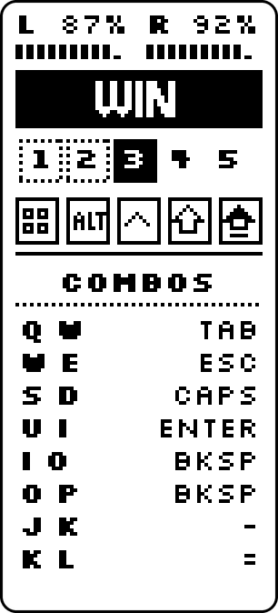</td>
    <td align="center">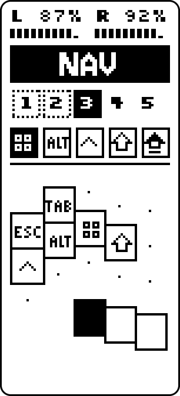</td>
  </tr>
  <tr>
    <td align="center">Slot 3</td>
    <td align="center">Slot 3, NAV held</td>
  </tr>
</table>

`src/os_layer.c` lists the Windows slots. It follows the selected slot rather than the connection,
so over USB the keys match whichever slot is selected.

## Power

| State | How it starts | How to wake it |
|---|---|---|
| Sleep | Automatic after 15 idle minutes on battery | Any key on that half |
| Soft off | Both Space thumbs + hold O for 2 seconds, then let go | Outer thumb on each half |
| Off | Power switch | Power switch |

Soft off is for wearing or carrying the keyboard. It turns off both halves at once, and only each
half's outer thumb wakes it, so stray presses on other keys do nothing. If a half won't wake, unplug
USB and turn its power switch off and on.

## Screens

<table>
  <tr>
    <td align="center">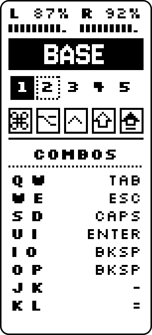</td>
    <td align="center">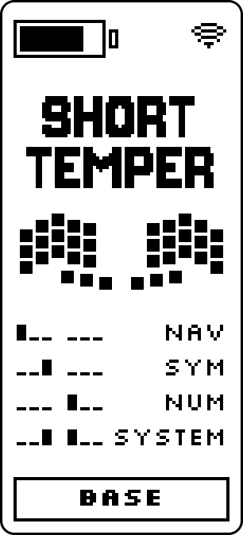</td>
    <td align="center">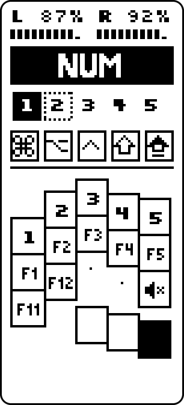</td>
    <td align="center">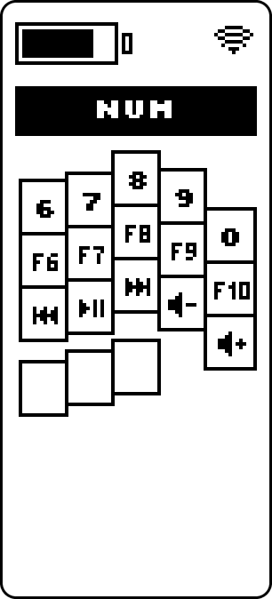</td>
  </tr>
  <tr>
    <td align="center" colspan="2">Base</td>
    <td align="center" colspan="2">NUM held</td>
  </tr>
  <tr>
    <td align="center">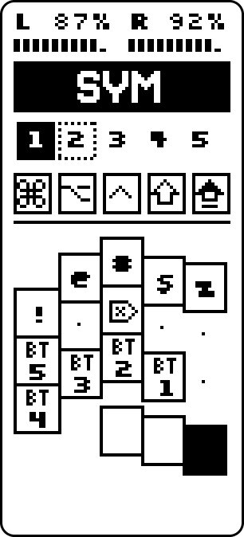</td>
    <td align="center">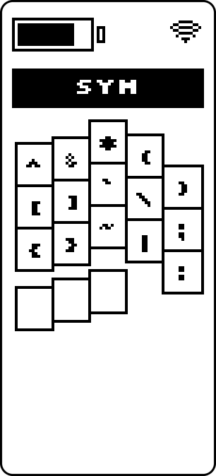</td>
    <td align="center">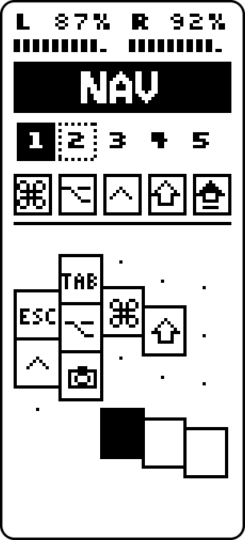</td>
    <td align="center">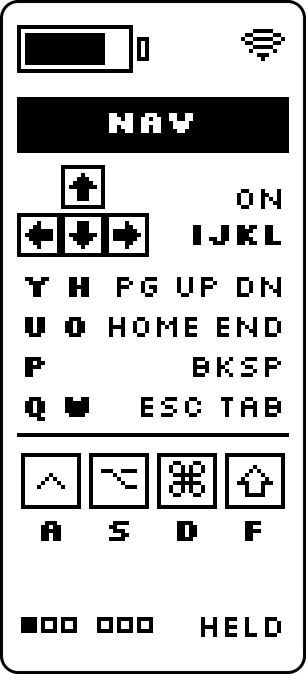</td>
  </tr>
  <tr>
    <td align="center" colspan="2">SYM held</td>
    <td align="center" colspan="2">NAV held</td>
  </tr>
  <tr>
    <td align="center">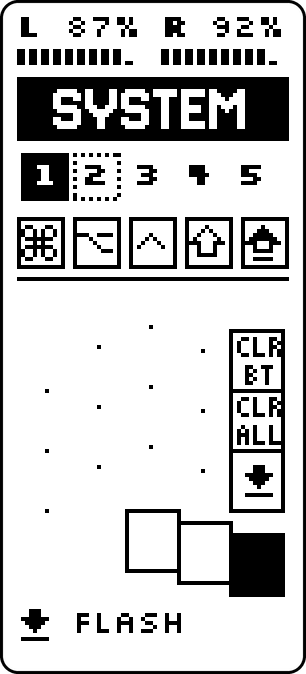</td>
    <td align="center">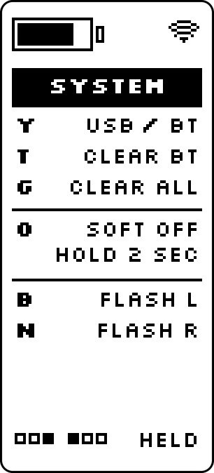</td>
  </tr>
  <tr>
    <td align="center" colspan="2">SYSTEM held</td>
  </tr>
</table>

The left screen shows both batteries, the layer, the five Bluetooth slots, held modifiers and Caps
Lock. Below them are the combos on Base, or the left hand's keys while you hold a layer. A filled
slot is in use, a double outline is selected but not connected, an outline is connected, and a
dashed outline is paired.

The right screen shows which thumbs open each layer on Base, and the right hand's keys while you
hold a layer. The left half sends it the layer, which needs the ZMK fork in `config/west.yml`.

Keys sit where they are on the board, stagger and all. The thumb you're holding is solid, and a key
that does nothing on that layer is a dot. A half on USB shows a bolt instead of a battery level,
because the nice!nano measures voltage and a charger holds it near full. The right half tells the
left when it's plugged in, so both screens show it. Your computer's Bluetooth battery reading still
says 100% for a charging half.

The screens cost little battery. They redraw only when a layer, modifier, battery level or
connection changes, and a screen holds its picture with almost no power. ZMK's display timer runs
100 times a second while you type and stops 30 seconds after the last key on that half, where the
stock nice!view settings keep it running.

Switch a half off and unplug USB before fitting or removing its screen, as pins pushed in at an
angle can touch their neighbours while powered. A new screen is full of random pixels until the
keyboard starts up and clears it. The keyboard only sends to the screen, so it can't tell whether
one is fitted and draws either way.

To change what the screens show, edit `art/screens.py` and run `uv run art/screens.py`. It writes
the firmware's images and icons to `boards/shields/nice_view_legend/widgets/`, and the images above.
Then build and flash both halves. [The shield's README](boards/shields/nice_view_legend/README.md)
explains how the halves share the layer and charging state.

## Thigh holster

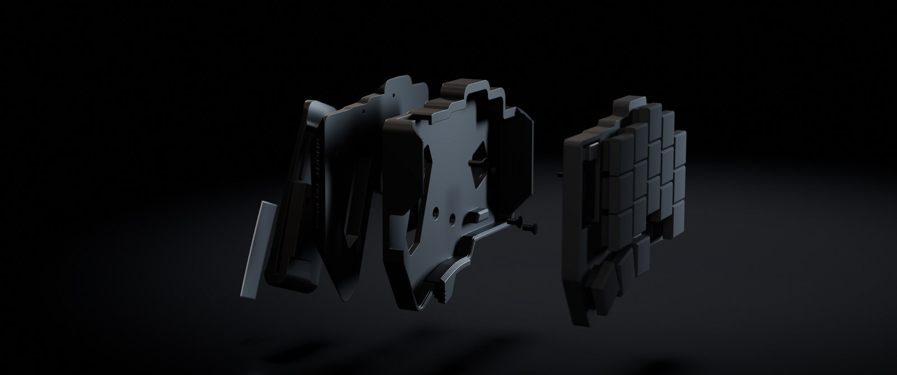

A 3D-printed holster wears each half on a thigh, clipped into a front pocket, and the keyboard lifts
straight out for desk use. [case/README.md](case/README.md) covers the parts, printing and assembly.

## Controller

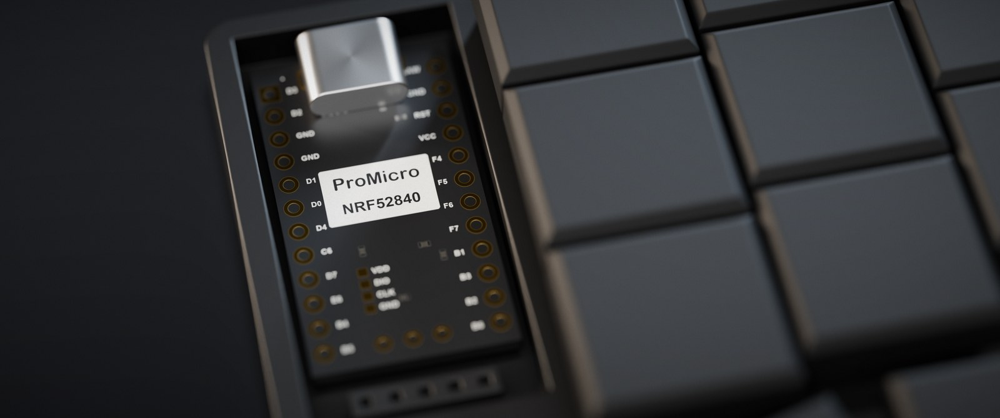

The right half's controller in its well. The nice!view plugs into the 5-pin socket below it.

## Known gaps

- Option is only on NAV, where the right hand's keys are navigation, so Option with a right-hand
  letter doesn't work.
- Shift on Base is only on the right outer thumb.

## What's different from upstream

- The left outer thumb taps Backspace instead of the Non-US Backslash key, which isn't much use on a
  Mac.
- The left middle thumb is a plain Cmd key, so shortcuts like Cmd+C work. The seller's key tapped
  Cmd and sent Ctrl when held, so Ctrl moved to holding the right middle thumb.
- Both inner thumbs are Space. The seller's left Space was on the middle thumb.
- SYM's right side adds the brackets, backslash, pipe, backtick and tilde, which the seller's keymap
  left out. Its bottom row is the home row shifted.
- `'` (Shift for `"`) takes the place of `;` right of L, as it's typed far more often. `;` and `:`
  moved to SYM.
- NAV replaces the seller's ARROWS layer, with navigation on the right hand, modifiers on the left
  home row, and Backspace on P.
- NUM adds F keys, volume and media, and drops the spare Backspaces on H and J.
- Combos only work on Base.
- It advertises as Short Temper (`config/temper.conf`), and `src/ble_name.c` replaces any older name
  stored in settings.
- Bluetooth adds a fifth slot, a key to clear one slot, and a USB/Bluetooth toggle. Slots are
  numbered from 1.
- Slot 3 gets Windows keys, from the WIN layer and `src/os_layer.c`.
- Tab is on Q + W.
- Sleep and soft off are new. The key matrix needed `wakeup-source` to wake from sleep.
- The bootloader and Clear Bluetooth keys moved from SYM, where rolling off Space could hit them, to
  SYSTEM. The right half gained a bootloader key.
- The diagrams are drawn from `config/temper.keymap` and the real PCB. The seller's workflow drew
  `boards/shields/temper/temper.keymap`, which the firmware doesn't use, and `config/temper.json`
  has the wrong stagger.
- The screens replace the stock nice!view ones. They need
  [cormoran's fork](https://github.com/cormoran/zmk) of ZMK v0.3, whose split relay events carry
  the layer to the right half.
- `build.sh` and `flash.sh` build and flash locally.

## Building and flashing

`build.sh` builds in Docker, with the west workspace in the `zmk-temper-ws` volume. Firmware goes
to `firmware/`, which git ignores.

```sh
./build.sh          # both halves
./build.sh left     # one target: left, right or reset
./build.sh update   # re-run west update after editing config/west.yml
```

`flash.sh` waits for the half's bootloader drive. Start it, plug that half in, then hold both Space
thumbs and press B for left or N for right. N only works while the right half is connected to the
left.

```sh
./flash.sh left
./flash.sh right
```

Both halves mount as `NICENANO`. After each half's first flash, the script remembers its USB serial
and refuses to flash one half's firmware onto the other, so take extra care the first time.

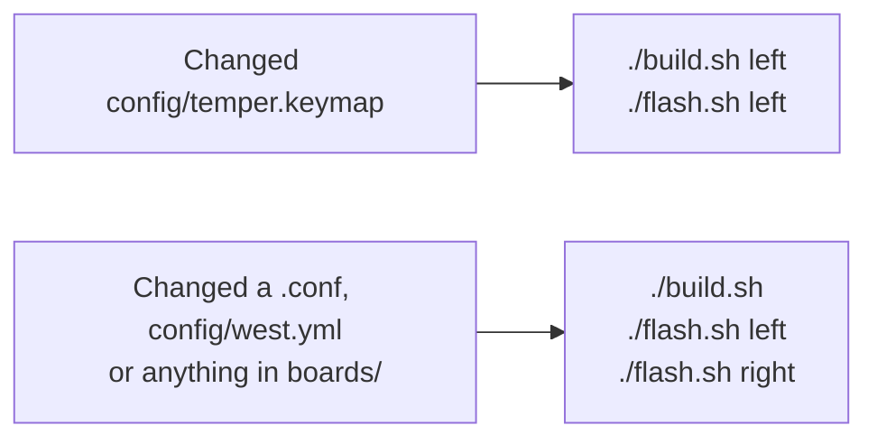

The left half runs the keymap, so keymap changes only need the left half flashed, except the first
time: flash both, so the halves don't run different firmware. If they don't reconnect afterwards,
run `./build.sh reset`, copy `firmware/temper_reset.uf2` onto each half's `NICENANO` drive by hand,
then flash left and right again. A reset clears that half's Bluetooth pairings.

Pushing to GitHub also builds the firmware in Actions, if they're enabled on the repo.

## Redrawing the diagrams

`.github/workflows/doc.yml` redraws them when the keymap changes on GitHub and commits the result, so
run `git pull --rebase` before pushing again. To redraw locally:

```sh
uvx --from keymap-drawer keymap -c keymap_img/keymap_drawer.config.yaml parse -c 10 -z config/temper.keymap > keymap_img/temper.yaml
uv run keymap_img/draw.py keymap_img/blueprint.yaml
```

`keymap parse` reads the keymap, and `keymap_img/draw.py` draws one sheet per layer. Settings are in
`keymap_img/blueprint.yaml`, and `keymap_img/temper-board.yaml` holds the measured key positions.

## Troubleshooting

If the bootloader keys don't work, there's no reset button to fall back on. The Temper design has
one, but it isn't fitted here, and the clone controllers don't have one either. With USB connected,
use tweezers to bridge the controller's `RST` and `GND` pins briefly, twice, quickly. Check the
labels first, because bridging `GND` and the battery pin next to it is a short circuit.

A half that looks dead on battery but works on USB needs charging. USB powers it either way, so
leave it plugged in with the switch on for an hour or so.

## Credits

- [Temper](https://github.com/gurland/temper) by raeedcho is the keyboard design, under the CERN
  Open Hardware Licence. The drawings use its key positions and board outline.
- [keymap-drawer](https://github.com/caksoylar/keymap-drawer) parses the keymap.
- [osifont](https://github.com/hikikomori82/osifont) is the lettering on the drawings.
- The screens use [Silkscreen](https://github.com/googlefonts/silkscreen) and
  [Jersey 10](https://github.com/scfried/soft-type-jersey), under the SIL Open Font License
  (`art/fonts/LICENSES`), and come from the screens on
  [Kyles Sofle](https://github.com/kylephillipsau/zmk-config-sofle).
