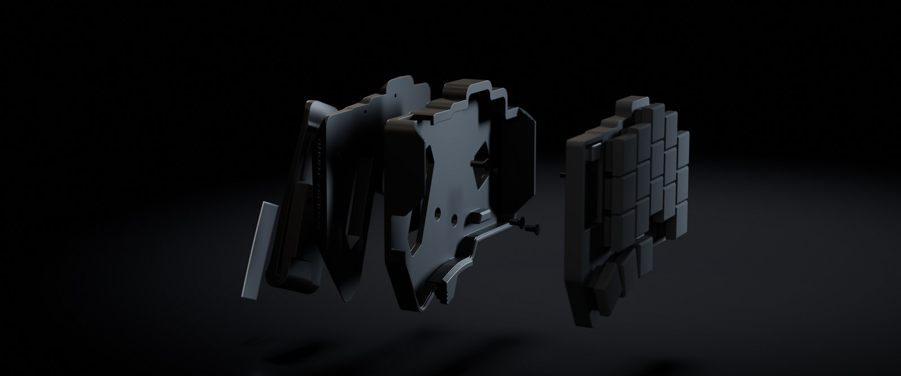

# Thigh holster

A holster for wearing the Temper on your thighs, with a swappable clip that goes into the pocket.
The keyboard's printed case isn't changed, and it lifts straight out for desk use.

The test fit has been printed, and the keyboard fits it. The full holster hasn't been printed yet.

## How it's worn

The right half goes on the right thigh, and the left half on the left. Each half turns 180 degrees
from how it sits on a desk, with the thumbs up and USB towards the knee, so your hanging hand meets
the keys the way it does at a desk. The keys face out.

The clip is a J, like a knife clip. It goes over the pocket edge and runs straight down inside the
pocket, so the seam carries the weight and the keyboard sits flush below the pocket edge. The top of
the J is cut at the pocket edge's angle, so it sits along the edge instead of on one corner.

## Side bumps

Knocks from the side are what's most likely to dislodge it, so these all work against them:

- The tongue runs 80 mm down inside the pocket, on the keyboard's centre line.
- Ribs along the tongue press the fabric into grooves in the holster. They slide in easily, and
  resist sideways slip.
- The clip's plate sits in a recess, so its walls take a sideways load instead of the screws.
- Bumpers on both sides stand just above the keycaps, so a knock lands on the holster. The right
  one stops short of the thumb-end corner, so the keyboard can still rock in at an angle. The left one
  starts above the power switch, so nothing stands beside the thumb keys. Both ramp up at 45 degrees
  instead of ending square.

The holster has no clearance for the optional nice!view screens, so take them off before you wear it.

## Parts

All of these come from `holster.py`, in `out/`, as STEP, STL and 3MF, for each side.

| Part | Print in | Notes |
|---|---|---|
| `outline-sheet` | Anything | Print this first, flat, with no supports. It's an open frame with the case's exact outline, 1 mm thick, and it does both halves: flip it over for the left |
| `test-fit` | Anything | Print this next, flat, with supports on and set to build plate only. Trees can reach a little way into the slit under the latch, so clear the slit with a thin blade afterwards. It's a thin slice with every fit in it |
| `holster` | PETG | Print with the keyboard side up. The back is curved, so use tree supports under all of it, set to build plate only to keep them out of the keyboard's pocket. They can still reach a little way into the slit under the latch, so clear it with a thin blade afterwards. That face sits against your leg, so marks there won't show |
| `holster-faceted-top` | PETG | The faceted holster's top, which holds the keyboard. It comes out keyboard side up, flat on its floor. Turn on supports set to build plate only, for the few that reach into the slit under the latch, and clear the slit with a thin blade afterwards |
| `holster-faceted-back` | PETG | The faceted holster's back, which sits on your leg. It comes out upside down, flat on the face that meets the top, so the side against your leg prints as a smooth top surface. It needs no supports |
| `clip` | Nylon, or PETG | Print on its long edge, so the layers run along the tongue, with 100% infill. Avoid PLA and carbon-filled filament, which are brittle |
| `clip-steel` | Same as `clip` | The same clip with a channel for a steel spine |

Each clip also needs two M3 x 4 heat-set inserts, 4.2 to 4.6 mm across, and two M3 x 6 countersunk
screws. A countersunk screw's length includes its head. The inserts go into the clip, and the screws
go in from the keyboard side, where the keyboard covers them. The clip's plate is flat on top and
bears straight on the 3 mm floor under the keyboard, so both heads sit flush and both screws get about
2.9 mm of thread in the insert.

### Plain or faceted

The two holsters fit the keyboard and the clip the same way. They differ only below the keyboard:

- **Plain:** a solid back that follows your leg, with its edges rounded where they meet it.
- **Faceted:** every face under the keyboard leans in at 45 degrees, the steepest a printer manages
  without supports. Two windows beside the clip go right through, the far ends of the rails ramp
  down at 45 degrees, and SHORT TEMPER is cut into the front face, reading the right way round on
  both halves. The tether goes through a tunnel across a corner instead of a lug, so nothing sticks
  out. It prints as two parts, so neither needs supports under it: see below.

`holster.py` prints a rough guess at the plastic each one takes: about 67 g of PETG for the plain one
before its supports, and about 40 g for the faceted top and 34 g for its back, which need none. Most
of the plain one's back is infill already, so reshaping it saves less than it looks, and splitting the
faceted one adds solid skins where the two parts meet.

### The faceted holster's two parts

It splits along the underside of the floor the keyboard sits on. The top holds everything the test
fit proved: the walls, lips, latch, rails, peg and floor. The back holds everything that depends on
your leg: its curve, the angles, and the depth. If it doesn't sit right on your leg, change `THIGH_R`,
`TILT`, `YAW` or `PITCH` and reprint just the back.

The clip's screws hold the clip to the top, through an opening in the back, so the clip's load never
goes through the joint. Two more screws hold the back to the top:

- Two M3 x 8 countersunk screws, which go in from the keyboard side and cut their own thread in the
  back. No inserts.
- Three pieces of 1.75 mm filament, each about 6 mm long, which line the parts up in their holes.

To put it together, push the filament pins into the back, press the top on, and drive the two M3 x 8
screws in snug, not tight, as they're threading into plastic. Then fit the clip with its own screws.
Once you're happy with how it sits, you can glue the two parts instead: sand both faces and use
two-part epoxy or a plastic-bonding superglue, as ordinary superglue holds PETG only moderately.

The faceted one touches your leg across about the same width in the middle, and less towards the
knee. That's untested.

### Steel spine

`clip-steel` seals in a strip of spring steel 12 to 13 mm wide, up to 0.7 mm thick and 49 mm long. A
0.6 or 0.7 mm blade from a feeler gauge set is the cleanest source, as long as its sides are parallel
and it's no wider than 13 mm. A piece of bi-metal hacksaw blade also works, as its back is flexible, if you cut it from the middle
to miss the end holes. Cut either with a rotary tool and a cut-off wheel, wear eye protection, and take
the burrs off the ends.

Printed on its long edge, the channel is open from the top until about 20.7 mm up, so add a pause
there, drop the strip in, and resume. Check the layer in your slicer's preview.

The strip's main job is to hold the clip together if the plastic ever cracks. It's only about a sixth
as stiff as the PETG around it, so the plastic still sets how hard the clip grips.

### Tether

Tie 4 mm paracord to a belt loop, so the keyboard can't hit the ground if the clip ever lets go. On
the plain holster it goes through the lug at the thumb end. On the faceted one it goes through a
tunnel across the thumb-end corner on the pinky side, in one face and out the other. Melt and taper
the cord's end to thread it through.

## Trial prints

Bambu Studio may say a 3MF from here has an invalid config and load the geometry only. These files carry
no print settings, so that's harmless, but you'll need to set them yourself. The STL loads the same shape.

Cheap filament and low infill are fine for checking fit and comfort, in this order:

1. **`outline-sheet`:** any filament, ironing off. Lay it on the table and set the right half on it,
   keycaps up. Run a fingernail around the join: the edges should be flush all the way round, within
   about 0.5 mm. The ring inside the frame is the slot: its outer edge is the slot's outline and its
   inner edge is the peg. For the clearest view of it, switch the half off, rest it upside down on its
   keycaps and lay the frame on its underside. The ring's outer edge should follow the slot, except
   along the side where it joins the rim. The notches should line up with the middle of the USB port and the power switch. Then flip the
   sheet over and do the same with the left half. Note where anything's out, and by how much.
2. **`test-fit`:** any filament, 2 walls, 15% infill. Run a thin blade through the slit under the
   latch first, as the arm starts in mid-air and can stick to the floor. Then check the keyboard drops
   in, the peg meets the slot, the lips hook on, and the latch clicks. If it's tight under the lips or
   the latch, shave any droop off their undersides before changing `CLEARANCE`.
3. **`holster` and `clip`:** 3 walls, 15% infill. Wear it, and check where it sits, how the rails feel,
   and how it reaches your hands.
4. **The final print:** the proper filament and settings from the table above.

Don't judge the clip's strength from a trial print. PLA is stiff and snaps easily, so it won't last.
If `CLEARANCE` was right in one filament, check it again in another, as they shrink differently.

## Fitting the keyboard

1. Slide the clip over the pocket edge, so the tongue goes down inside the pocket.
2. Hook the USB end under the lips at the bottom of the holster.
3. Rock the keyboard in, so the peg goes into the slot.
4. Press the thumb end until the latch clicks.

The walls and rails are chamfered, so it finds its way in by feel. To take it out, slide your thumb
along the wall to the grooved paddle on the latch, push it along the edge, away from the slit, and
lift the thumb end. The paddle stands out from the wall, so the push levers the latch open. It has
no hook or gap, so it won't catch on clothes.

## Changing the fit

The settings are at the top of `holster.py`. Rerun it with `uv run case/holster.py`.

| Setting | What it does |
|---|---|
| `CASE_H` | Height of the printed case, measured at 8 mm |
| `CLEARANCE` | Gap around the case. Raise it if the test fit is tight |
| `THIGH_R` | Radius of the curve behind the holster |
| `TILT` | How far the fingers point away from straight down |
| `YAW` | How far the keys turn towards your palm. The front edge stands further off the leg |
| `PITCH` | How far the thumb end stands further off the leg than the USB end |
| `POCKET_ANGLE` | The slope of the pocket edge, where the clip goes over it |
| `TONGUE_DEPTH` | How far the clip reaches below the pocket edge. Keep it shorter than the pocket |
| `BACK_MAX` | The deepest the holster gets behind the keyboard |
| `CLIP_PRELOAD` | How hard the clip grips. The script prints the force, and the strain it puts on the plastic |

The case outline in `case-outline.json` is traced from photos of the real case's underside, about
116.5 x 95.7 mm. Each half's bottom plate follows the PCB, so its edges, against the exact outline in
`keymap_img/temper-board.yaml`, flatten the photo to true scale with no ruler, fitting to 0.06 mm. The
two halves mirror each other to about 0.1 mm, and the file is their average. The wall isn't even: it's
about 2.5 to 2.7 mm on most edges, and up to about 3.1 mm along the thumb edge, which is one smooth curve
where the board has straight sections. `board_corner` says where the board sits in that outline, so the
USB port, switch and keys all follow it. `SLOT` is about 17.2 x 8.9 mm, measured from the board the same way.
